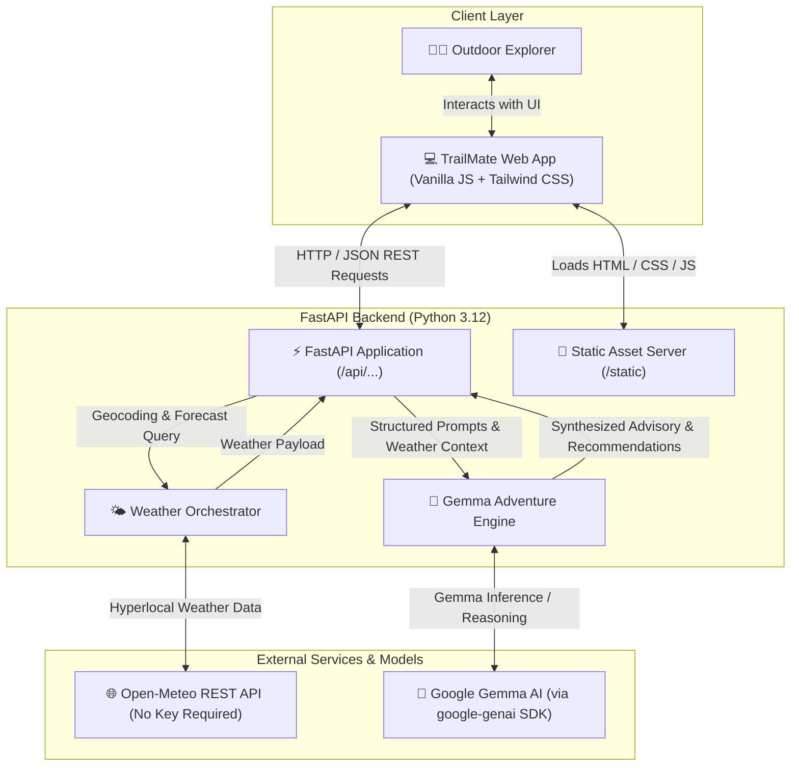

# 🌿 TrailMate — AI-Powered Outdoor Adventure Companion

[](https://www.python.org/)
[](https://fastapi.tiangolo.com/)
[](https://ai.google.dev/gemma)
[](https://hacktoberfest.com/)
[](LICENSE)

> **Step away from the screen, lace up your boots, and explore the wild with confidence.**  
> TrailMate combines real-time meteorological intelligence with Google's state-of-the-art Gemma open-weight models to plan safer, smarter, and more immersive outdoor adventures.

---

## 📌 Table of Contents

- [Overview](#-overview)
- [Why Open-Source & Open-Weight AI Matters](#-why-open-source--open-weight-ai-matters)
- [The 'Touch Grass' Theme](#-the-touch-grass-theme)
- [Features](#-features)
- [System Architecture](#-system-architecture)
- [Tech Stack](#-tech-stack)
- [Project Structure](#-project-structure)
- [Quick Start](#-quick-start)
- [API Reference](#-api-reference)
- [Screenshots & UI Preview](#-screenshots--ui-preview)
- [Hacktoberfest 2026 Submission](#-hacktoberfest-2026-submission)
- [Deployment](#-deployment)
- [Contributing](#-contributing)
- [License & Author](#-license--author)

---

## 🌲 Overview

**TrailMate** is an intelligent outdoor adventure copilot engineered specifically for hikers, backpackers, trail runners, and nature enthusiasts. By fusing live hyperlocal atmospheric data from **Open-Meteo** with the reasoning capabilities of **Gemma** via the `google-genai` SDK, TrailMate transforms raw trail and weather metrics into actionable, life-saving, and delightful trail guidance.

Whether you are preparing a quick afternoon hike through a suburban nature reserve or embarking on a multi-day alpine expedition, TrailMate evaluates weather thresholds, terrain difficulty, daylight windows, and your individual fitness level to generate personalized itineraries, custom gear checklists, and ecological insights.

---

## 💡 Why Open-Source & Open-Weight AI Matters

Most modern AI assistants rely on walled-garden APIs that treat outdoor data like ordinary web traffic. For outdoor adventure applications, open-weight models like **Google Gemma** represent a seismic paradigm shift:

| Pillar | Why Open-Weight AI (Gemma) Changes the Game |
| :--- | :--- |
| 🔒 **Absolute Data Privacy** | Hiker telemetry, planned backcountry routes, emergency contacts, and sensitive geolocation data never need to be retained or mined for advertising. Users retain sovereign ownership over their expedition logs. |
| 🏕️ **Offline & Edge-Readiness** | Cellular coverage vanishes in backcountry valleys and mountain summits. Open weights provide the foundational path to running high-performance quantized models locally on edge devices, ruggedized laptops, or off-grid field units without an active internet connection. |
| ⚙️ **Domain Customization** | Gemma models can be guided through deep system instructions, localized wilderness safety rubrics, regional flora/fauna guidelines, and Leave-No-Trace principles without platform lock-in. |
| 💸 **Zero Token Tax & Scalability** | Open-source architectures liberate developers and non-profits from exorbitant per-token commercial API pricing, enabling sustainable community-driven trail safety tools accessible to all explorers. |

---

## 🌱 The 'Touch Grass' Theme

In an era dominated by relentless screen time, algorithm-driven feeds, and sedentary remote work, the Hacktoberfest 2026 Week 1 challenge issues a crucial directive: **Touch Grass**.

TrailMate embraces this philosophy not as a cliché, but as a deliberate design mandate:
- **AI that gets you away from AI:** Instead of optimizing for endless screen engagement, TrailMate's UI and API are designed for *rapid departure*—giving you exactly what you need to know in under two minutes so you can put your phone away and immerse yourself in nature.
- **Ecological Stewardship:** Every expedition recommendation integrates **Leave No Trace (LNT)** guidelines and regional conservation advisories to ensure that touching grass preserves the grass for future generations.
- **Confidence for Beginners:** Fear of getting lost or unpreparedness is the #1 barrier keeping people indoors. TrailMate removes friction by automating packing lists, risk checks, and trail selection.

---

## ✨ Features

- 🗺️ **Intelligent Trail Matchmaker**: Context-aware trail recommendations matched to your available time, fitness tier, terrain preference, and party composition (solo, family, dog-friendly).
- ⛅ **Hyperlocal Weather & Risk Synthesis**: Seamless Open-Meteo integration fetching temperature, humidity, wind gusts, precipitation probability, and weather codes, analyzed dynamically by Gemma to detect risks like hypothermia, flash floods, or lightning.
- 🧭 **Interactive Deep-Dive Roadmap**: Click any adventure card to generate an immersive, step-by-step nature itinerary featuring starting point coordinates, trail markers, sensory immersion quests, and secret ranger tips.
- 📅 **Add to Calendar (.ics)**: Native calendar invite generator exporting `.ics` files directly from the browser to schedule outdoor excursions in Google Calendar, Apple Calendar, or Outlook.
- 💾 **Private User-Isolated Saved Trails**: Device-scoped trail bookmarking powered by private `localStorage` with MongoDB Atlas cloud synchronization, keeping each user's saved adventures strictly private.
- 📴 **Offline Roadmap Export**: Download full deep-dive adventure roadmaps as plain text (`.txt`) files so you can navigate the outdoors with zero cellular connection.
- 🎒 **Dynamic Gear Checklist Engine**: Generates granular, weather-adapted packing lists categorized into Essentials, Safety, Clothing Layers, and Hydration/Nutrition based on current atmospheric conditions.
- 🐾 **Flora, Fauna & Ecological Advisor**: Field guidance on regional wildlife encounters, poison plant identification reminders, and Leave-No-Trace practices.
- 🚨 **Wilderness Protocol & Safety Briefing**: Pre-trip emergency planning checklists including emergency contacts protocol, turnaround times, and elevation adjustment steps.
- 🔊 **ElevenLabs Audio Guides**: One-click neural voice text-to-speech audio narration for trail descriptions and saved itineraries.
- 💬 **Conversational Nature Copilot**: Natural, empathetic dialogue powered by `gemma-4-26b-a4b-it` to answer complex "what-if" outdoor questions.
- 🍃 **Serene Nature-Themed UI**: Calming earth tones and forest greens styled with Tailwind CSS, built with zero heavyweight frontend frameworks for lightweight mobile browser loading.

---

## 🏗️ System Architecture

TrailMate is architected as an asynchronous, decoupled system prioritizing low latency, high resilience, and clean separation between presentation, orchestration, and intelligence layers.



### Architectural Workflow

1. **User Input**: The user selects or inputs a destination city/park and adventure preferences.
2. **Weather Retrieval**: The FastAPI server queries Open-Meteo's geocoding and forecast endpoints for real-time temperature, wind, humidity, and precipitation data.
3. **Context Fusion & Prompt Construction**: The backend synthesizes the raw meteorological metrics with domain-specific outdoor safety rules into a structured prompt.
4. **Gemma Reasoning**: Google's `gemma-4-26b-a4b-it` model parses the conditions, formulates risk evaluations, and generates custom gear and itinerary recommendations.
5. **Streamlined Delivery**: The unified response is delivered via FastAPI and rendered on the nature-themed dashboard.

---

## 🛠️ Tech Stack

| Technology | Category | Purpose | Justification |
| :--- | :--- | :--- | :--- |
| **Python 3.12** | Runtime | Core Backend | High performance, modern async syntax, and broad library compatibility. |
| **FastAPI** | Web Framework | API & Static Hosting | High-speed ASGI framework with native async support and automatic OpenAPI docs. |
| **Uvicorn** | ASGI Server | Production Server | Blazing fast lightning-tier ASGI web server implementation. |
| **Google GenAI SDK** | AI Client | Gemma Model Interface | Official SDK (`google-genai`) supporting modern interaction abstractions. |
| **Gemma 4** | Foundation Model | Outdoor Reasoning | Google's premier open-weight model (`gemma-4-26b-a4b-it`), offering enterprise-grade reasoning with privacy. |
| **Open-Meteo** | Weather API | Meteorological Data | Free, open-access, zero-API-key weather and geocoding engine with high resolution. |
| **HTTPX** | HTTP Client | Async Weather Requests | Modern, fully async HTTP client for non-blocking external API calls. |
| **MongoDB Atlas** | Database | User-Scoped Saved Trails | Cloud NoSQL document database for persisting private user-tagged trail bookmarks. |
| **ElevenLabs** | Voice AI | Audio Trail Guide | High-fidelity neural voice synthesis engine narrating trail itineraries aloud. |
| **Tailwind CSS** | Styling | Nature-Themed UI | CDN-delivered utility CSS crafted with earth greens, forest palettes, and clean typography. |
| **Vercel & Render** | Cloud Hosting | Decoupled Deployment | Edge static delivery for the frontend on Vercel and scalable Python hosting on Render. |

---

## 📁 Project Structure

```text
trailmate/
├── .env.example          # Environment variable template
├── LICENSE               # MIT Open Source License
├── README.md             # Comprehensive project documentation
├── render.yaml           # Backend deployment blueprint for Render
├── requirements.txt      # Python dependencies with pinned versions
├── backend/
│   └── main.py           # FastAPI application entrypoint & AI endpoints
└── frontend/
    ├── index.html        # Nature-themed responsive dashboard
    └── app.js            # Frontend logic, weather fetching, Calendar ICS generation
```

---

## 🚀 Quick Start

### 1. Prerequisites
- **Python 3.12+** installed on your system
- A Gemini / Gemma API Key from [Google AI Studio](https://aistudio.google.com/apikey)
- Git

### 2. Clone the Repository
```bash
git clone https://github.com/wide-shunks-67/trailmate.git
cd trailmate
```

### 3. Create a Virtual Environment
```bash
# On Linux/macOS
python3 -m venv venv
source venv/bin/activate

# On Windows
python -m venv venv
.\venv\Scripts\activate
```

### 4. Install Dependencies
```bash
pip install -r requirements.txt
```

### 5. Configure Environment Variables
Copy the example environment file and add your Google AI Studio key:
```bash
cp .env.example .env
```
Edit `.env`:
```env
GEMINI_API_KEY=your_actual_api_key_here
```

### 6. Launch the Application
Start the FastAPI server from the `backend/` directory:
```bash
cd backend
uvicorn main:app --reload --host 127.0.0.1 --port 8000
```

Open `frontend/index.html` in your web browser. Interactive API documentation is available at `http://127.0.0.1:8000/docs`.

---

## 📡 API Reference

TrailMate provides a clean, predictable RESTful API:

| Method | Endpoint | Description |
| :--- | :--- | :--- |
| `GET` | `/api/health` | Healthcheck endpoint reporting server and model connection status. |
| `POST` | `/api/adventures` | Analyzes weather context and preferences to return curated itineraries. |
| `POST` | `/api/challenge` | Generates a rapid, 15-minute "Touch Grass" micro-challenge. |
| `POST` | `/api/roadmap` | Generates a deep-dive, step-by-step nature guide for a specific adventure. |
| `POST` | `/api/save` | Persists a bookmarked adventure to MongoDB Atlas tagged by user ID. |
| `GET` | `/api/saved` | Retrieves private saved adventures for a specific user (`?user_id=`). |
| `DELETE` | `/api/saved/{trail_id}` | Removes a specific saved trail for a user. |
| `POST` | `/api/tts` | Synthesizes trail descriptions into audio via ElevenLabs. |

### Sample Request: Trail Recommendations
`POST /api/adventures`
```json
{
  "location": "Boulder, Colorado",
  "activity": "Hiking",
  "difficulty": "Moderate",
  "duration_hours": 4
}
```

### Sample Response: Trail Recommendations
```json
{
  "location": "Boulder, Colorado",
  "weather_summary": "18°C, Partly Cloudy, 12 km/h Wind, 0% Rain",
  "recommendations": [
    {
      "trail_name": "Chautauqua Trail to Royal Arch",
      "distance_km": 5.5,
      "elevation_gain_m": 425,
      "safety_advisory": "Dry conditions expected. Bring 2L water and sun protection.",
      "leave_no_trace_tip": "Stay on the designated rocky switchbacks to prevent trail erosion."
    }
  ]
}
```

---

## 📸 Screenshots & UI Preview

> *The UI features a soothing nature-inspired palette (forest greens, warm ambers, sandstone tones) designed to keep information clear and readable in direct sunlight.*


---

## 🏆 Hacktoberfest 2026 Submission

This project is created and submitted as an official entry for **Hacktoberfest 2026 — Week 1 Challenge**:
- **Theme**: *Touch Grass*
- **Objective**: Harness open-source tools and open-weight AI to inspire developers and tech communities to disconnect from digital exhaustion and safely immerse themselves in the natural world.
- **AI Model**: Google's open-weight **Gemma** (`gemma-4-26b-a4b-it`), illustrating how modern open intelligence powers edge-ready, privacy-respecting consumer tools.

---

## 🌐 Deployment

TrailMate is pre-configured for automated continuous deployment on platforms like [Render](https://render.com).

A ready-to-use `render.yaml` specification is included in the root directory:

```yaml
services:
  - type: web
    name: trailmate
    runtime: python
    buildCommand: pip install -r requirements.txt
    startCommand: uvicorn main:app --host 0.0.0.0 --port $PORT
    envVars:
      - key: GEMINI_API_KEY
        sync: false
      - key: PYTHON_VERSION
        value: 3.12.9
```

To deploy on Render:
1. Fork or push this repository to GitHub.
2. In the Render Dashboard, create a **New Blueprint Instance**.
3. Link your repository; Render will automatically detect `render.yaml`.
4. Enter your `GEMINI_API_KEY` in the Render environment settings.

---

## 🤝 Contributing

Contributions make the open-source community an inspiring place to learn, inspire, and create. Any contributions you make are **greatly appreciated**!

1. Fork the Project
2. Create your Feature Branch (`git checkout -b feature/AmazingFeature`)
3. Commit your Changes (`git commit -m 'Add some AmazingFeature'`)
4. Push to the Branch (`git push origin feature/AmazingFeature`)
5. Open a Pull Request

Please review our code style guidelines and ensure all tests pass before opening a PR.

---

## 📄 License & Author

Distributed under the **MIT License**. See [`LICENSE`](LICENSE) for full details.

- **Author**: Ansh Tayal
- **DEV Profile**: [@anshtayal02](https://dev.to/anshtayal02)
- **Challenge**: Hacktoberfest 2026 — Week 1 (*Touch Grass*)

---

<p align="center">
  Made with 🌲 and ❤️ for outdoor explorers everywhere. Remember to leave no trace.
</p>
